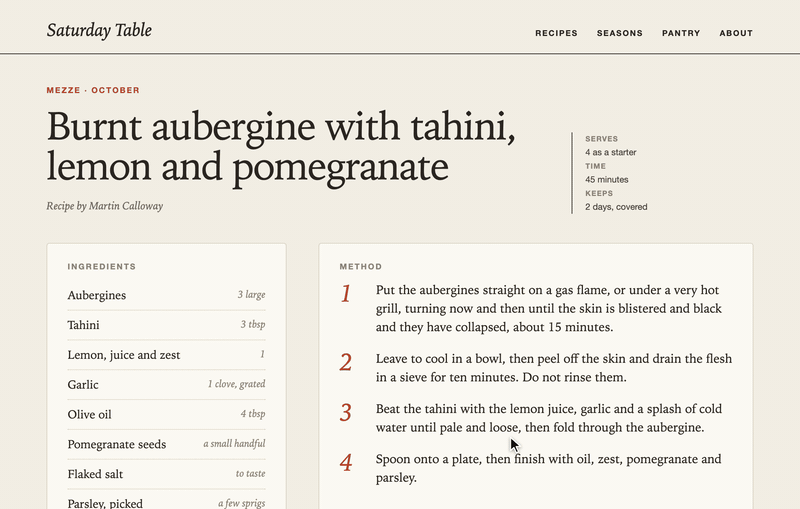

# Souvenir



I made Souvenir to gather screenshots of elements without having to crop them or remove their backgrounds. Right-click a card, a chart or a whole section and it lands on your clipboard as a PNG with transparent corners, ready to paste into Figma, Slack or a doc. It works like selecting a frame in Figma.

The ones you want to keep go in a collection in the side panel, where you can name them, search them, copy their colour palette as JSON and drag them back out.

Made by [Katerina Vassiliou](https://katerinavassiliou.xyz/?utm_source=github&utm_medium=souvenir).

## Try it

Install it from the [Chrome Web Store](https://chromewebstore.google.com/detail/souvenir/dkicjffhbimipempjaihknglgkjcjfla).

To load it yourself instead:

1. Clone this repo, or download the zip from the [latest release](https://github.com/katerina-vassiliou/souvenir/releases/latest) and unzip it.
2. Go to `chrome://extensions` and turn on Developer mode.
3. Choose Load unpacked and pick the folder.

It should work in any Chromium browser that has the side panel: Chrome, Edge, Brave, Arc.

## Using it

Right-click an element and choose Collect element, or press ⌘⇧E (Ctrl+Shift+E on Windows and Linux) with the pointer over something.

Move the pointer to highlight a container. The first time you use Souvenir on a page, nothing is highlighted until the pointer moves. The up arrow selects its parent and the down arrow goes back. Click or press Enter to collect it, or Esc to back out. The image is copied straight away, and you can choose Keep in collection on the message that appears.

Click the toolbar icon to open your collection. Press ? in there for help and / to search.

If the shortcut does nothing, another extension probably has it. You can change it at `chrome://extensions/shortcuts`.

## How it captures

There are two ways to get an element into an image, and Souvenir picks one for you.

**Render** draws the element from the page itself. It's quick, it doesn't scroll anything, and it handles any height. It can't reproduce video or embedded frames, and images that haven't loaded are missing from the result.

**Screenshot** scrolls the element through the window, takes a screenshot at each step and stitches them together. It's slower, but it gets exactly what's on screen.

On Smart, the default, Souvenir tries Render first and falls back to Screenshot if it fails, if the element has video or iframes in it, or if an image the site won't let the page read comes out blank. You can pin either one in Settings.

Sticky headers and bottom bars are hidden while it captures so they don't end up in the middle of your image, and anything that loads as you scroll is given a chance to load first.

## What it asks for

Souvenir doesn't ask for access to every site. Chrome gives it access to the current tab only when you start a capture from the right-click menu or the shortcut.

- Active tab, for exactly that. Nothing runs on a page until you use Souvenir on it.
- Scripting, to load Souvenir into that page when you start a capture.
- Context menu, for the right-click item.
- Clipboard write, to copy the image.
- Storage, for your souvenirs and settings. Nothing is uploaded; see the [privacy policy](docs/PRIVACY.md).
- Side panel, for the collection.

## Working on it

There's no build step. Load the folder as an unpacked extension, edit, and reload it from `chrome://extensions`.

```sh
npm install
npm run check    # lint, formatting and tests
npm run format
npm run package  # writes dist/souvenir-<version>.zip
```

```
src/background/   menu, shortcut, loading Souvenir into the tab, tab screenshots
src/content/      runs in the page: picker, capture, animation, toast
src/shared/       settings, souvenirs and message names
src/sidepanel/    the collection
vendor/           modern-screenshot
test/             unit tests
```

Souvenir is loaded into a page only when you start a capture on it, as ES modules, so pages you never collect from pay nothing for it.

Bug reports and pull requests are welcome. See [CONTRIBUTING.md](CONTRIBUTING.md).

## Licence

MIT, see [LICENSE](LICENSE). The libraries Souvenir includes are listed in [THIRD_PARTY_NOTICES.md](THIRD_PARTY_NOTICES.md).
